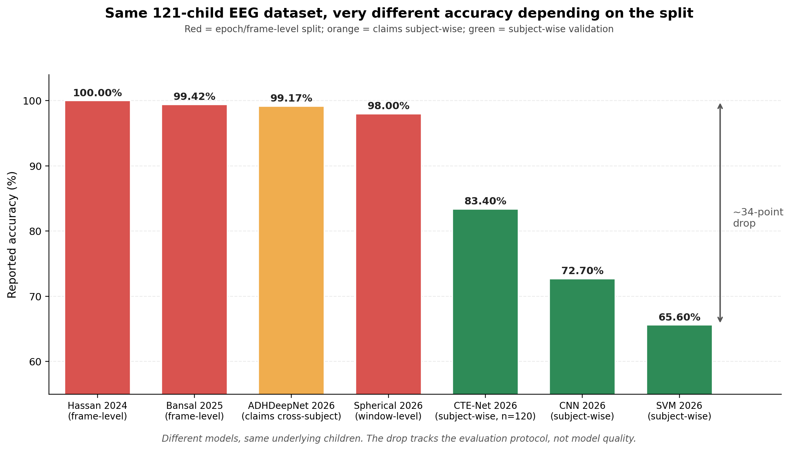

# ADHD Detection Model — Research + EEG Pipeline

This folder contains a literature review, a structured paper database, and a working subject-wise EEG pipeline.

## Files

| File | What it is |
|---|---|
| [`research/ADHD_detection_literature_review.md`](research/ADHD_detection_literature_review.md) | Full review: methodologies, datasets, 40+ papers, accuracy caveats, and a build plan |
| [`research/adhd_papers.csv`](research/adhd_papers.csv) | Sortable table of papers with modality, dataset, n, method, validation, accuracy/AUC, PMID, DOI |
| [`research/accuracy_inflation_eeg.png`](research/accuracy_inflation_eeg.png) | Bar chart: same EEG dataset, 65.6%–100% depending on the split |
| [`research/make_accuracy_chart.py`](research/make_accuracy_chart.py) | Script that regenerates the chart |

## Web app — NeuroScan AI (ADHD EEG screening)

A MediScan-style FastAPI front end for the deployable SVM. It accepts a 19-channel recording or runs one of two held-out demos, shows a screening score with the band/connectivity snapshot behind it, and then lists real Pune ADHD specialists with phone numbers and a Google Map.

### Run it

```bash
python -m pip install -r requirements.txt

# Only needed if models/adhd_svm_select150.joblib is absent:
python scripts/train_deploy_model.py

python -m uvicorn app.main:app --reload --port 8000
```

Open <http://127.0.0.1:8000>.

**Input:** `.npy`, `.csv`/`.txt`, or `.mat`. The array can be `(n_times, 19)` or `(19, n_times)`, with channels ordered `Fp1, Fp2, F3, F4, C3, C4, P3, P4, O1, O2, F7, F8, T7, T8, P7, P8, Fz, Cz, Pz`. Set the original sampling rate in the UI; the server resamples to 128 Hz, band-passes 0.5–45 Hz, applies a 50 Hz notch, builds 5-second epochs, and averages the per-epoch SVM votes.

### Held-out demos

- `data/real/recordings/v10p.npy` — ADHD group (subject `v10p`)
- `data/real/recordings/v107.npy` — control group (subject `v107`)

Both subjects are excluded from the shipped artifact (`models/model_metadata.json` records `n_train_subjects: 119` and `excluded_subjects: ["v107", "v10p"]`), so their predictions are genuinely out-of-sample. Retrain with `python scripts/train_deploy_model.py --include-demo-subjects` to put them back in-sample. The web app serves a single fit; the 69.4% / AUROC 0.747 figures come from the 3-repeat majority vote, while the conservative single-model estimate is 66.4% ± 1.3%.

### Specialists and the map

The default directory contains eight real Pune clinics/hospitals that assess ADHD and related concerns, each with a phone number, address, and Google Maps link. The embedded map uses Google's public embed, so no key is required for the map view.

Live Google Places results in any city are optional. To enable them:

1. In Google Cloud, enable **Places API (New)** — not the legacy Places API, which new projects can no longer enable.
2. Create an API key restricted to **Places API (New)**.
3. Put the key in the `.env` file at the project root:

```dotenv
GOOGLE_MAPS_API_KEY=AIza...
```

If `.env` is missing, copy the template first:

```powershell
Copy-Item .env.example .env
```

4. Restart the server:

```powershell
python -m uvicorn app.main:app --reload --port 8000
```

`app/main.py` loads `.env` at startup, and `.env` is git-ignored. A real environment variable overrides the file, so CI or a host can still inject the key:

```powershell
$env:GOOGLE_MAPS_API_KEY = "AIza..."
```

The backend reads `GOOGLE_MAPS_API_KEY` (or `GOOGLE_PLACES_API_KEY`) in `app/doctors.py`. Put it only in `.env` or the server environment — never in `app/static/app.js`, `index.html`, or committed code.

Verify live results with:

```powershell
Invoke-RestMethod "http://127.0.0.1:8000/api/doctors?city=Mumbai" |
  Select-Object source, @{n='count';e={$_.doctors.Count}}
```

`source` should be `google_places`. Without a key, a non-Pune city shows only the Google Map search, not fabricated listings. The curated data was checked against the clinics' official pages; fees, timings, and specialties still need confirmation by phone.

### API

| Endpoint | Purpose |
|---|---|
| `GET /api/health` | Model artifact and metadata status |
| `GET /api/meta` | Metrics, channels, bands, demo availability |
| `POST /api/analyze` | Multipart `file` + `source_fs` → screening result |
| `GET /api/demo/{adhd\|control}` | Run a held-out demo recording |
| `GET /api/doctors?city=Pune` | Curated / Google Places specialists + map URLs |
| `GET /api/doctors?lat=…&lng=…` | Distance-sorted listings near a point |

**Safety:** the score is a research screening signal, not a diagnosis. The UI says this next to every result, and the specialist section exists precisely because a clinical assessment is the only valid confirmation.

## Working pipeline (EEG, subject-wise)

The route with the best credible deep-learning AUROC is **EEG**: CTE-Net reports **AUC 0.902** with subject-wise validation (PMID 42817338). This repo scaffolds that idea — a transformer over channel-wise spectral features with directed-connectivity bias — plus a raw-signal EEGNet baseline.

A GraphSAGE fMRI paper claims AUC 0.96, but it is a multi-site outlier with likely site leakage. CTE-Net is the best result that survives subject-wise validation.

### Quick start

```bash
python -m pip install -r requirements.txt

# 1) Synthetic smoke test (no download)
python scripts/make_synthetic_data.py --out data/synthetic --subjects 40 --duration 60
python scripts/run_cv.py --config configs/eeg_cte.yaml --quick

# 2) Harder synthetic set for the leakage demo
python scripts/make_synthetic_data.py --out data/synthetic_hard --subjects 80 --duration 120 --class-effect 0.25 --identity-strength 0.8
python scripts/leakage_demo.py --config configs/eeg_cte.yaml --data-root data/synthetic_hard
python scripts/run_cv.py --config configs/eeg_cte.yaml --data-root data/synthetic_hard --quick

# 3) EEGNet baseline
python scripts/run_cv.py --config configs/eeg_cte.yaml --data-root data/synthetic_hard --model eegnet --quick
```

**What the synthetic run showed (harder set):**

| Check | Result |
|---|---|
| CTE-Net, 3-fold quick, subject-level | AUROC **0.871**, accuracy **0.775** |
| CTE-Net, 5-fold full, subject-level | AUROC **0.826**, accuracy **0.688** |
| Logistic regression, epoch-level split | accuracy **92.8%**, AUROC **0.982** |
| Logistic regression, subject-level split | accuracy **78.7%**, AUROC **0.842** |
| Leakage gap | **14.1 accuracy points** |
| EEGNet raw-signal baseline | AUROC **0.567** — overfit without augmentation |

These numbers verify that the code runs and that the split logic changes the answer. They are **not** evidence about ADHD.

**Calibration warning:** in the synthetic full run, one fold had AUROC 1.0 but accuracy 0.5 at the default 0.5 threshold — every probability was just above 0.5, so every subject was predicted ADHD. That is a calibration problem, not a ranking problem. AUROC/AUPRC are the primary metrics here; for deployment, choose the operating threshold on validation data or calibrate probabilities.

### Real data result (121 children, IEEE DataPort)

Downloaded, prepared, and evaluated with `configs/eeg_cte_real.yaml`. Subject-wise 5-fold CV, 2,918 epochs, 121 subjects (61 ADHD / 60 control).

| Check | Result |
|---|---|
| **CTE-Net, 5-fold subject-wise** | **AUROC 0.673** (95% CI 0.576–0.768) |
| Accuracy | **0.628** (95% CI 0.545–0.719) |
| Sensitivity / specificity | 0.672 / 0.583 |
| AUPRC / Brier / ECE | 0.635 / 0.233 / 0.112 |
| Published clean SVM on the same data | 65.6% |
| Published clean CNN on the same data | 72.7% (AUC 0.72) |
| Published leaky segment-wise SVM | 90.0% |
| Published headline CNN | 100% |

The reimplementation lands between the published clean SVM and CNN — and far below the 90–100% headlines. With 121 subjects the confidence interval is wide; fold AUROCs ranged from 0.57 to 0.80.

### Improvement round (real data)

I tested the improvements that could plausibly raise subject-level accuracy. Every number below is subject-wise; decision thresholds are chosen on validation subjects, never on the test fold.

| Step | AUROC | Accuracy | Verdict |
|---|---:|---:|---|
| CTE-Net reimplementation | 0.673 | 0.628 | baseline |
| + ICA blink removal | 0.508 | 0.529 | rejected — removed real frontal signal |
| Classical RBF-SVM, node + adjacency + relative power | 0.719–0.753 | 0.678–0.694 | clearly better |
| RBF-SVM + SelectKBest 150 (fit inside each fold) | 0.739 ± 0.016 | 0.664 ± 0.013 | best single model |
| 3-repeat majority vote | **0.747** (0.656–0.834) | **0.694** (0.612–0.777) | final |

**Best final accuracy: 69.4%** (95% CI 61.2–77.7%), with AUROC **0.747**, sensitivity 0.852, and specificity 0.533. The model is an RBF SVM on log band power, relative band power, and directed-connectivity edges, with 150 features selected inside each training fold. It was evaluated with 3 repeats of subject-wise 5-fold CV; the reported prediction is the majority vote of the three repeats.

The conservative single-model estimate is **66.4% ± 1.3%** across repeats. The 69.4% vote is the same result after variance reduction, not a different model. Both are single-site estimates with a wide CI, and the configuration was chosen after comparing several models on these same subjects, so the top number is optimistic. A clean external cohort would likely land nearer 65–70%. Per-repeat predictions and summaries are in `results/final_validation/`.

ICA was tested and rejected: it dropped AUROC from 0.66 to 0.51, likely because it removed frontal theta/alpha activity that carries group information. The pipeline therefore uses z-score epoch rejection only. The ADHD group was medicated (Ritalin up to 6 months), which can suppress group differences.

### What it does

- **Subject-wise splits** — `StratifiedKFold` on subject IDs; validation subjects are disjoint from training subjects. No epoch from a test child appears in training.
- **Preprocessing** — resample → µV → notch → 0.5–45 Hz band-pass → 5-s epochs → per-recording channel z-score.
- **Features** — log power in delta/theta/alpha/beta/gamma + theta/beta ratio; directed connectivity from a ridge-regularised VAR (a fast stand-in for directed transfer entropy).
- **Models** — `CTENet` (graph attention over electrodes with connectivity bias) and `EEGNet` (raw-signal CNN baseline).
- **Evaluation** — subject-level AUROC/AUPRC/accuracy/sensitivity/specificity/PPV/NPV/Brier/ECE with bootstrap CIs; per-fold Youden thresholds chosen on validation subjects; optional repeated CV with majority vote; ROC, PR, calibration, confusion, and per-fold plots.
- **Outputs** — `results/<model>/` with `metrics.json`, out-of-fold predictions, fold metrics, training history, and figures.

### Project structure

```text
configs/eeg_cte.yaml          # synthetic smoke-test settings
configs/eeg_cte_real.yaml     # real 121-child dataset settings
data/README.md                # manifest format and public dataset links
app/                          # FastAPI app, frontend, specialist directory
models/                       # deployable SVM artifact + metadata + feature cache
scripts/make_synthetic_data.py
scripts/prepare_ieee_dataset.py  # .mat -> .npy + manifest for the 121-child set
scripts/train_deploy_model.py    # trains the web app artifact (holds out demos)
scripts/run_cv.py
scripts/classical_baseline.py    # LR / SVM / RF / ExtraTrees / HistGB comparison
scripts/feature_search.py        # feature-set and SVM/tree search
scripts/final_validation.py      # repeated subject-wise CV for the finalists
scripts/ensemble_validation.py   # repeat-vote metrics and bootstrap CIs
scripts/leakage_demo.py
src/config.py                 # config dataclasses
src/data.py                   # loading, preprocessing, epoching, subject splits
src/features.py               # band power, PLV, VAR-based directed connectivity
src/models.py                 # CTENet + EEGNet
src/train.py                  # training and cross-validation
src/evaluate.py               # metrics and bootstrap CIs
src/plots.py                  # evaluation figures
src/synthetic.py              # synthetic EEG generator
tests/test_pipeline.py        # unit tests
```

### Real data

The recommended first download is the [IEEE DataPort 121-child EEG dataset](https://ieee-dataport.org/open-access/eeg-data-adhd-control-children) — 61 ADHD / 60 controls, 19 channels, 128 Hz, free IEEE account, CC BY 4.0. See [`data/README.md`](data/README.md) for that and other public cohorts (ADHD-200, ABCD, HBN, BALLADEER).

After extracting the archives under `data/real/raw/`, prepare the recordings and manifest:

```bash
python scripts/prepare_ieee_dataset.py
python scripts/run_cv.py --config configs/eeg_cte_real.yaml --quick

# Classical baselines and repeated validation of the finalists
python scripts/classical_baseline.py --config configs/eeg_cte_real.yaml
python scripts/feature_search.py --config configs/eeg_cte_real.yaml
python scripts/final_validation.py --config configs/eeg_cte_real.yaml --repeats 3
python scripts/ensemble_validation.py
```

Put recordings under `data/` and create a manifest:

```csv
subject_id,label,site,file
sub-001,1,A,sub-001.npy
sub-002,0,A,sub-002.npy
```

Then run:

```bash
python scripts/run_cv.py --config configs/eeg_cte.yaml --data-root data/real
```

See [`data/README.md`](data/README.md) for supported formats and public dataset links. Set `data.n_channels` and `data.fs` to match your montage. Omit `--quick` for the full 5-fold run.

### Caveats

- The CTE-Net implementation is a clean reimplementation of the published idea, not the authors' code.
- The classical search compared several dozen feature/model configurations on the same 121 subjects. The winner's score is therefore optimistic; the repeated-CV estimate reduces split noise, not selection bias.
- The `granger` connectivity is a VAR-coefficient proxy, not a formal transfer-entropy or Granger-causality test.
- Synthetic results are a plumbing check. Real claims require real data, subject-wise validation, and external validation.
- The 95% CI on 121 subjects is roughly ±8 accuracy points. A second cohort could easily move the result by more than any modeling gain here.
- This is a research/screening tool, not a diagnostic device. At low prevalence, PPV is much lower than accuracy suggests.

## The three answers you asked for

### 1) Paper with the highest reported accuracy

**Hassan & Singhal (2024), _Health Information Science and Systems_**
- 2-layer CNN on 19-channel EEG
- 121 children (61 ADHD / 60 healthy controls)
- **100% accuracy, sensitivity, and specificity**
- PMID 39224441 · DOI 10.1007/s13755-024-00305-7

**Important:** this is a **frame-level** result (5-second EEG frames), not a subject-level result. The same public dataset scores **72.7%** with a CNN under subject-wise validation. Treat 100% as a headline, not a target.

### 2) Highest accuracy using deep learning

**Headline:** **ADHDeepNet — Amini et al. (2026)**
- 99.17% accuracy, 100% sensitivity
- Nested 10-fold **cross-subject** validation
- Same 121-child dataset
- PMID 42899621

**Most credible:** **CTE-Net — Gomez-Rivera et al. (2026)**
- 83.4% participant-level accuracy, AUC 0.902
- 120 children, 5 subject-wise folds × 10 repetitions
- PMID 42817338

**Best on a large public benchmark:** **AE-STEN — Li et al. (2026)**
- 76.06% ± 0.65% on 747 ADHD-200 subjects across 7 sites
- PMID 41740109

### 3) Paper with the largest dataset

**Largest overall:** **ESPM-ADHD — Wang et al. (2026)**
- **26,726 children**, 15 school/home features, Random Forest
- External AUROC 0.929 / 0.907; AUPRC 0.298 / 0.253
- Questionnaire-based screening, not a biomarker test
- PMID 41620184

**Largest neuroimaging:** **ABCD study** — 11,880 children, 21 sites
- Structural MRI paper: 6,916 children, AUROC **0.567** (Gaus et al., 2023, PMID 38054056)
- rs-fMRI paper: 775 after QC, AUC **0.740** (Wang et al., 2023, PMID 36746929)

## The one thing to understand before building

The ADHD ML literature has a **leakage problem**. Most 96–100% results come from splitting EEG **epochs** randomly instead of splitting **children**. The model then recognises the individual child rather than the disorder.

The cleanest evidence:

| Same 121-child EEG dataset | Leaky segment CV | Clean subject CV |
|---|---:|---:|
| SVM on PSD features | 90.0% | **65.6%** |
| CNN on raw EEG | — | **72.7%** (AUC 0.72) |

Source: Geethapriya & Pattabiraman (2026), PMID 42903275.



**Realistic targets:**
- EEG, single-site, subject-wise: **72–83%** accuracy; AUC 0.75–0.90
- fMRI, multi-site ADHD-200: **70–76%** accuracy; AUC 0.75–0.80
- MRI meta-analysis: AUC ~0.81
- Questionnaire screening at scale: AUROC 0.90+, but low PPV at real prevalence

## Recommended first build

**Option A — EEG (fastest, laptop-scale) — scaffolded above**
- Data: IEEE DataPort 121-child EEG dataset (61 ADHD / 60 controls, 19 channels, 128 Hz)
- Split: `GroupKFold` by subject; no epoch overlap
- Baselines: logistic regression / SVM / RF on PSD + connectivity
- Model: CTE-Net-style graph transformer (implemented) + EEGNet baseline
- Target: 72–83% subject-level accuracy
- Explainability: Grad-CAM / SHAP (next step)

**Option B — fMRI (most publishable)**
- Data: ADHD-200 preprocessed (776 labelled; 8 sites)
- Features: AAL116 static + dynamic FC, ALFF/ReHo, phenotype
- Split: subject-level 10-fold + leave-one-site-out
- Models: SVM baseline → BrainNetCNN/GNN → spatiotemporal transformer
- Target: 70–76% within site; 60–65% cross-site

**Option C — questionnaire screening (highest headline accuracy)**
- Data: SNAP-IV / ASRS / NHANES or a local cohort (aim for 5,000+)
- Model: XGBoost/LightGBM + SHAP
- Target: AUROC 0.90+; report AUPRC and PPV

**Option D — multimodal (best long-term)**
- Data: BALLADEER (EEG + eye tracking + EDA) or HBN
- Target: 80–85% accuracy with subject-wise validation

## Suggested next steps

1. Download the real 121-child EEG dataset and build a manifest (`data/README.md`).
2. Run the subject-wise baseline and the CTE-Net scaffold on it.
3. Add augmentation to the EEGNet baseline (noise, time shift, channel dropout).
4. Add explainability: channel/band importance and connectivity edge attribution.
5. Report AUROC, AUPRC, sensitivity, specificity, PPV/NPV, and calibration — not just accuracy.
6. If the single-site result holds, replicate on a second cohort or site.

## Read these five papers first

1. Geethapriya & Pattabiraman (2026) — leakage-aware EEG benchmark. PMID 42903275.
2. Tian et al. (2024) — MRI ML meta-analysis. PMID 38580035.
3. Brown et al. (2012) — ADHD-200 competition results. PMID 23060754.
4. Gaus et al. (2023) — ABCD structural MRI, 6,916 children. PMID 38054056.
5. Li et al. (2026) — AE-STEN, 747 subjects, 76.06%. PMID 41740109.
