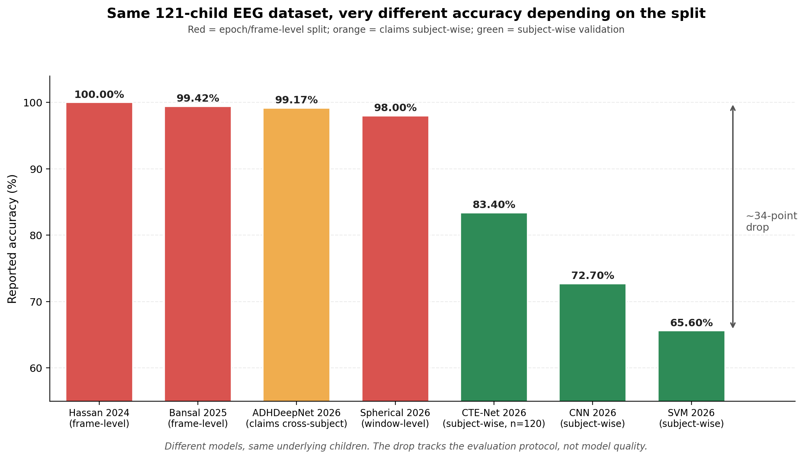

# ADHD Detection: Literature Review, Dataset Guide, and Build Plan

**Prepared:** 13 November 2026  
**Scope:** Peer-reviewed studies indexed in Europe PMC / PubMed through November 2026. Focus is ADHD vs typically developing controls (binary classification), with notes on ADHD subtype classification. Modalities covered: EEG, fMRI/sMRI, multimodal physiology, eye tracking, wearables, ECG/fNIRS, and questionnaire/behavioural models.  
**Search:** ~190 records for “ADHD + deep learning”, ~194 for “ADHD-200”, ~100 ML review records, plus targeted searches for EEG, fMRI, ABCD, eye-tracking, wearable, and meta-analysis papers. 60+ abstracts were read and 40+ studies extracted.

---

## 0. The short answer

| Question | Best answer | Reported number | What it actually proves |
|---|---|---|---|
| **1. Paper with the highest accuracy** | **Hassan & Singhal (2024)**, *Health Information Science and Systems* — 2-layer CNN on 19-channel EEG | **100% accuracy, sensitivity, and specificity** | Only a **frame-level** result on 121 children (61 ADHD / 60 controls). No subject-wise split is reported. This is a headline number, not a generalisation estimate. |
| **2. Highest accuracy using deep learning, with subject-wise validation** | **ADHDeepNet — Amini et al. (2026)**, *Biomedical Physics & Engineering Express* | **99.17% accuracy, 100% sensitivity** with nested 10-fold **cross-subject** validation | Same 121-child dataset. An independent leakage-aware re-analysis of this dataset found a CNN at **72.7%** subject-wise. Treat 99.17% as an outlier / upper bound, not a reproducible target. |
| **2b. Most credible deep-learning result** | **CTE-Net — Gomez-Rivera et al. (2026)**, *Sensors* | **83.4% participant-level accuracy, AUC 0.902** | 120 children, 5 fixed subject-wise folds, 10 repetitions. This is close to the realistic ceiling for single-site EEG. |
| **2c. Best deep learning on a large public benchmark** | **AE-STEN — Li et al. (2026)**, *IEEE J Biomed Health Inform* | **76.06% ± 0.65%** | 747 ADHD-200 subjects across 7 sites. Represents realistic multi-site fMRI performance. |
| **3. Paper with the largest dataset** | **ESPM-ADHD — Wang et al. (2026)**, *Journal of Affective Disorders* | **26,726 children**; external AUROC **0.929 / 0.907**, AUPRC **0.298 / 0.253** | Largest ADHD *screening* model, but questionnaire-based, not a biomarker model. At ~2% prevalence, AUPRC ~0.30 means many false positives. |
| **3b. Largest neuroimaging dataset** | **ABCD** (11,880 children, 21 sites). Key ML papers: Gaus et al. 2023 (6,916 children, sMRI, **AUROC 0.567**) and Wang et al. 2023 (775 after QC, rs-fMRI, **AUC 0.740**). | See above | ABCD is the biggest paediatric brain cohort, but ADHD signal in structural MRI is weak; rs-fMRI is moderate. |

### The one-sentence conclusion

> **The “99%” ADHD papers are almost all small, single-site EEG studies evaluated on overlapping windows from the same children. The defensible state of the art is roughly 72–83% subject-level accuracy for EEG, 70–76% for multi-site fMRI, and AUROC ~0.80 for MRI-based meta-analysis — not 99%.**

---

## 1. The two literatures you will find

ADHD machine-learning papers fall into two almost non-overlapping worlds.

### World A — headline papers

- Small samples (often 40–220 participants), usually one site.
- EEG or hand-crafted features.
- Very high accuracy: 96–100%.
- Validation is often **window-level / epoch-level**: 5-second frames from the same child appear in both training and test sets.
- Little or no external validation.
- Frequently reuse the same public 121-child EEG dataset.

### World B — benchmark papers

- Multi-site cohorts (ADHD-200, ABCD, NeuroIMAGE, HBN).
- 500–11,000 participants.
- Accuracy mostly 60–76%, AUC 0.65–0.81.
- Subject-level or leave-one-site-out validation.
- Explicit discussion of site effects, motion, comorbidity, and confounds.

The gap is not because World B uses worse models. It is because World A’s evaluation protocol lets the model recognise **the individual child**, not the disorder.

A concrete demonstration: Geethapriya & Pattabiraman (2026) evaluated the same 121-child EEG dataset two ways:

| Model | Segment-wise CV (leaky) | Subject-wise CV (clean) | Drop |
|---|---:|---:|---:|
| SVM on power-spectral-density features | **90.0%** | **65.6%** | −24.4 points |
| CNN on raw EEG | — | **72.7% ± 9.3%** (AUC 0.72) | — |

That is the single most important paper in this review for anyone building an ADHD model. Read it first (PMID 42903275).



*The same underlying children produce anywhere from 65.6% to 100% depending on whether epochs or subjects are split. Different models are involved, but the protocol is the dominant factor.*

---

## 2. Methodologies used in the literature

### 2.1 Classical machine learning on questionnaires and behavioural data

**Typical pipeline:** demographic + SNAP-IV / ASRS / Conners / CBCL / K-CPT scores → feature selection (Boruta, LASSO, SHAP) → RF / XGBoost / LightGBM / SVM / logistic regression.

**Strengths:** large samples, cheap, deployable as a triage tool, interpretable with SHAP.

**Weaknesses:** the label is usually a rating scale, not a clinical diagnosis; performance is inflated by symptom overlap between the questionnaire and the label; PPV is low at real-world prevalence.

**Representative papers:**

- **ESPM-ADHD (Wang et al., 2026)** — 26,726 children, 15 features, Random Forest, external validation in two provinces. AUROC 0.929 / 0.907, AUPRC 0.298 / 0.253. The best large-scale screening result in this review.
- **CAT-based model (Cha et al., 2025)** — 11,429 participants, 8 ML models, >98% accuracy on a balanced dataset. Large, but the balanced design and >98% figure need independent replication.
- **SNAP-IV short form (2026)** — 410 ADHD / 3,607 controls plus a 676 / 374 replication cohort; 4 parent and 6 teacher items retained. Useful for screening, not diagnosis.

### 2.2 EEG

EEG is the most common modality in the high-accuracy literature.

**Preprocessing:** band-pass (0.5–45 Hz), notch, ICA or canonical correlation analysis (CCA) for artefact removal, segmentation into 2–20 s epochs, normalisation.

**Features:**

- Power spectral density (delta, theta, alpha, beta), especially frontal/central theta and beta.
- Functional connectivity: Pearson correlation, phase-locking value (PLV), transfer entropy, coherence.
- Nonlinear: entropy, fractal dimension, Hjorth parameters, recurrence plots, symbolic time-series analysis.
- Time-frequency images: spectrograms, scalograms, wavelet coefficients.

**Models:**

- Classical: SVM, RF, kNN, logistic regression.
- Deep: CNN, ResNet, EEGNet/DeepConvNet, LSTM/BiLSTM, attention, transformers, Siamese networks, graph networks.
- Explainability: Grad-CAM, SHAP, LIME, channel/band importance.

**Reported range:** 65–100%. Credible subject-wise range: **72–83%** on the 121-child public dataset; **83.4%** for CTE-Net.

**Main datasets:** the IEEE DataPort 121-child dataset (61 ADHD / 60 controls, 19 channels, 128 Hz, ages 7–12, visual attention task), the BALLADEER multimodal dataset (2026), Southeast University three-class data, and various private hospital cohorts.

**Key problem:** almost every 98–100% EEG paper uses overlapping epochs. A model can learn each child’s individual alpha peak, impedance profile, or artefact pattern and achieve near-perfect training-set separation. Subject-wise cross-validation removes this shortcut and typically costs 15–30 accuracy points.

### 2.3 fMRI and structural MRI

**Typical features:**

- ROI-wise BOLD time series (AAL116, Schaefer, Harvard-Oxford).
- Static functional connectivity (Pearson, partial correlation, sparse representation).
- Dynamic functional connectivity (sliding windows, high-order FC, dHOFC).
- Voxel-wise measures: ALFF/fALFF, ReHo, voxel-mirrored homotopic connectivity.
- Structural: cortical thickness, surface area, subcortical volumes, structural connectivity.

**Models:** SVM, multiple-kernel learning, 3D CNN, BrainNetCNN, graph convolutional networks, GraphSAGE, transformers, autoencoders, normative modelling.

**Reported range:** 60–76% for honest multi-site evaluation; meta-analytic AUC 0.81. A few papers claim 89–99%, but they usually use a favourable subset, a single site, or transductive feature selection.

**Canonical benchmark:** ADHD-200 — 776 labelled participants (491 typically developing, 285 ADHD) from 8 sites, ages 7–21; 973 participants including the competition test set. Public via NITRC and the Neuro Bureau.

**Why it is hard:** site/scanner effects are large; ADHD is heterogeneous; head motion correlates with diagnosis; medication and comorbidity confound labels; structural differences are small (effect sizes d ≈ 0.1–0.3).

### 2.4 Multimodal models

**Combinations:** EEG + eye tracking + electrodermal activity (EDA) + heart-rate variability (HRV) + actigraphy + questionnaires + VR task performance.

**Fusion:** early (feature concatenation), late (decision fusion), attention-based fusion, stacked ensembles.

**Reported range:** 80–97%, but usually small samples (n = 50–220). The best-validated examples use an independent test set or subject-wise CV:

- **VR adult ADHD (Wiebe et al., 2024)** — 50 training / 36 independent test participants; 81% accuracy on the test set. EEG features did not add value; eye tracking, head movement, and task performance carried the signal.
- **Eye tracking (Liu et al., 2024)** — 216 children; AUC 0.965, accuracy 0.908 with 5-fold CV.
- **VR-EEG-oculomotor (Lin et al., 2026)** — 101 children; 83% accuracy with early fusion, 79% with ERP-only.
- **Wearable EEG + K-CPT + ratings (Chen et al., 2024)** — 78 preschool children; 97.4% ensemble, but very small.

### 2.5 Other modalities

- **Eye tracking:** prosaccade/antisaccade, fixation stability, gaze trajectory, pupil diameter. AUC 0.84–0.965 in small studies; promising, cheap, but task-dependent.
- **Wearables/actigraphy:** Fitbit/Apple Watch activity, sleep, heart rate. AUC 0.80–0.95 depending on sample size; PPV is low in population screening.
- **ECG:** 1D CNN on 2-second epochs reached 96.04% in 123 children (Loh et al., 2023), but this is epoch-level and not externally validated.
- **fNIRS:** prefrontal haemodynamics during Go/NoGo or arithmetic tasks; emerging, typically 70–85% in small samples.
- **Video/audio:** facial action units, head pose, speech; research-grade, not yet standardised.
- **Genetics:** polygenic scores add variance but are not a standalone diagnostic classifier.

---

## 3. Datasets you can actually use

| Dataset | n | Ages | Modalities | Access | Notes |
|---|---:|---|---|---|---|
| **ADHD-200** | 776 labelled (491 TDC / 285 ADHD); 973 with competition test set | 7–21 | rs-fMRI, sMRI, phenotype | Public (NITRC, Neuro Bureau) | 8 sites. The canonical benchmark. Strong site effects. Best honest accuracy ~70–76%. |
| **ABCD** | 11,880 | 9–10 at baseline | sMRI, rs-fMRI, questionnaires, wearables, genetics | Public via NDA (application) | 21 US sites. Largest paediatric brain cohort. After QC, ML papers often use 775–6,916 children. ADHD labels from KSADS. |
| **HBN (Healthy Brain Network)** | 8,000+ evaluated | 5–21 | EEG, MRI (early years), questionnaires, cognitive tests | Public via COINS / OpenNeuro | Transdiagnostic community sample; excellent for comorbidity and real-world heterogeneity. |
| **NeuroIMAGE** | 1,069 children (751 from ADHD families; 318 controls) | Children → young adults | sMRI, rs-fMRI, fMRI, genetics, cognition | Public / collaboration | Dutch cohort; includes unaffected siblings; useful for familial designs. |
| **IEEE DataPort 121-child EEG** | 121 (61 ADHD / 60 HC) | 7–12 | 19-channel EEG, 128 Hz | Public | Visual attention task; single site; heavily reused by 99% papers. Good for a methods project, not for clinical claims. |
| **BALLADEER** | n/r in abstract | Children/adolescents | EEG + eye tracking + EDA | Public (2026) | New multimodal dataset; promising for fusion work. |
| **Southeast University EEG** | n/r | Children | EEG | Private | Three classes: ADHD-inattentive, ADHD-combined, typically developing. |
| **ESPM-ADHD cohort** | 26,726 | 6–18 | School + home questionnaires | Private | Three regions in China; largest screening cohort. |
| **CAT cohort** | 11,429 | Children | Comprehensive Attention Test | Private | South Korea; 7,737 ADHD, 850 normal comparison. |
| **SNAP-IV cohorts** | 4,017 + 1,050 | Children | Parent/teacher rating scales | Private | Taiwan; useful for short-form screening. |
| **NHANES** | ~10,000+ | Children/adolescents | Questionnaires, demographics | Public | US population data; ADHD parent-report; good for epidemiological screening models. |
| **UK Biobank** | ~500,000 | Adults | Questionnaires, imaging subset | Application | Adult ADHD; not a paediatric detection benchmark. |

### Dataset choice by goal

- **Learn the methods quickly / laptop-scale:** 121-child EEG dataset.
- **Publishable, comparable, multi-site:** ADHD-200.
- **Large-scale, well-powered, multimodal:** ABCD or HBN (but access and preprocessing costs are higher).
- **High-accuracy screening demo:** SNAP-IV/ASRS/NHANES or the ESPM-style questionnaire design.
- **Multimodal fusion:** BALLADEER or HBN.

---

## 4. Key papers

A sortable version of this table, with PMIDs and DOIs, is in [`adhd_papers.csv`](adhd_papers.csv).

### 4.1 EEG studies

| Study | Year | Data (n) | Method | Validation | Reported | Verdict |
|---|---:|---|---|---|---|---|
| Hassan & Singhal | 2024 | 121 (61/60), 19-ch, IEEE DataPort | 2-layer CNN + CCA on 5-s frames | Frame-level; no subject-wise split reported | **100%** acc/sens/spec (19-ch); 99.08% frontal | Headline only; leakage risk |
| Bansal et al. | 2025 | 121 (61/60) | Autoencoder + ResNet + double attention | Not clearly subject-wise | 99.42% | Inflated |
| Amini et al. (ADHDeepNet) | 2026 | 121 (61/60) | Temporal–spatial attention CNN | Nested 10-fold **cross-subject** | **99.17%**, 100% sens | Outlier; same data yields 72.7% in clean re-analysis |
| Siamese CNN | 2024 | Paediatric EEG (n/r) | Siamese CNN on PSD brain maps | n/r | 99.17% | Inflated |
| Ni et al. (TFS-FENet) | 2025 | Southeast University 3-class | CNN + attention on time–frequency–space features | n/r | 99.36% binary; 96.89% 3-class | Private data; needs replication |
| Att-CNN | 2024 | Public EEG | PCC + PLV connectivity maps + attention CNN | n/r | 98.88% | Inflated |
| ADHD-AttentionNet | 2025 | Public EEG | NeuroDCT-ICA + RFO feature selection + attention net | n/r | 98.52% | Inflated |
| Spherical phase-space + BiLSTM | 2026 | 121 (61/60) | Symbolic time-series analysis + BiLSTM | 20-s window-level | 98% | Inflated |
| PABiLSTM ensemble | 2025 | Two datasets | Spectrogram/fractal/recurrence + ResNet-50 + BiLSTM | n/r | 98.91 / 99.10% | Inflated |
| Zavitaev et al. | 2026 | Public EEG | Transformer + LIME | Leave-one-out | 96.2% | Likely epoch-level LOO |
| MCRNet (Sanchis et al.) | 2025 | Public EEG (n/r) | Multi-head CNN + RNN | **Cross-subject** | 94.87%, recall 98.33% | More credible; dataset details limited |
| **CTE-Net (Gomez-Rivera et al.)** | 2026 | 120 (60/60) | Transformer + directed transfer entropy | 5 fixed **subject-wise** folds × 10 | **83.4%** participant; AUC **0.902** | **Most credible EEG deep-learning result** |
| **Geethapriya & Pattabiraman** | 2026 | 121 (4,173 epochs) | LR/RF/SVM; LSTM/CNN/CNN-BiLSTM | Segment-wise vs **subject-wise** | 90.0% → **65.6%** (SVM); CNN **72.7%** | **Read this first — leakage benchmark** |
| Chen et al. | 2024 | 78 (43/35) | Wearable EEG + K-CPT + rating scales, ensemble | CV | 97.4% ensemble; EEG 95.0% | Small, multimodal |

### 4.2 fMRI and structural MRI studies

| Study | Year | Data (n) | Method | Validation | Reported | Verdict |
|---|---:|---|---|---|---|---|
| Brown et al. (ADHD-200 competition) | 2012 | 973 | 21 teams; fMRI, phenotype | Competition holdout | Best **62.52%**; average 49.8% | Historical benchmark; phenotype-only won |
| DeepFMRI (Riaz et al.) | 2020 | ADHD-200 NYU | End-to-end CNN + functional connectivity | Subject-level | 73.1% (spec 91.6%, sens 65.5%) | Credible baseline |
| 3D CNN (fALFF/ReHo) | 2025 | ADHD-200 NI/NYU/PU | 3D CNN | 5-fold | 76.19 / 69.92 / 70.77% | Credible |
| **AE-STEN (Li et al.)** | 2026 | 747, 7 sites | Attention spatiotemporal network | Subject-level | **76.06% ± 0.65%** | **Best realistic multi-site result** |
| BrainNetCNN (López et al.) | 2026 | 465, 4 sites | BrainNetCNN + static/dynamic FC | Within-site 10-fold; leave-one-site-out | AUC 50.1–64.5%; LOSO 44.4–63.9% | Shows poor cross-site transport |
| GraphSAGE (Bousmaha et al.) | 2026 | ADHD-200 multi-site | PLV + GraphSAGE | Site and combined | 0.89 acc, 0.96 AUC | Outlier; verify site leakage |
| Transformer structural connectivity (Shi et al.) | 2025 | 947, 8 centres | Transformer on structural connectivity | 5-fold | 71.9%, AUC 0.74 | Credible |
| Att-GCN | 2026 | ADHD-200 subsets | Graph attention + ALFF/FC | Binary hypothesis | 93.1% in 11-region right limbic system | Suspicious region subset; needs replication |
| Tang et al. | 2022 | ADHD-200 (973) | Autoencoder + binary hypothesis | LOO | 99.6% | Leakage risk |
| **Gaus et al. (ABCD sMRI)** | 2023 | **6,916** | Advanced ML on 136 regional volumes/thicknesses | CV + permutation | **AUROC 0.567** | Large cohort; weak structural signal |
| **Wang et al. (ABCD rs-fMRI)** | 2023 | 775 after QC | Multiple FC measures + multiple-kernel learning | Nested CV | **AUC 0.740**, acc 0.6916 | Large cohort; moderate signal |
| **Tian et al. (meta-analysis)** | 2024 | 43 studies; 27 pooled | ML on sMRI/fMRI | Meta-analysis | Sens 0.74, spec 0.75, **AUC 0.81** | Best summary estimate |
| Deepika et al. (KAN) | 2025 | ADHD-200 | Kolmogorov–Arnold network + attention | Benchmark | 79.25% | Efficient, promising |
| VoxSTNet | 2026 | Multi-site raw BOLD | 3D CNN + spatiotemporal | Subject-wise z-score | Results n/r in abstract | Emerging |
| BRAINMAP | 2026 | 447 ADHD + 845 TDC (3 datasets) | Dynamic FC + GNN + Mamba | Multi-dataset | Results n/r in abstract | Emerging |

### 4.3 Multimodal, wearable, eye-tracking, and behavioural studies

| Study | Year | Data (n) | Method | Validation | Reported | Verdict |
|---|---:|---|---|---|---|---|
| **ESPM-ADHD (Wang et al.)** | 2026 | **26,726** | RF/XGBoost/LightGBM/LR on 15 school–home features | External validation (2 provinces) | AUROC **0.929 / 0.907**; AUPRC 0.298 / 0.253 | Largest; screening only |
| CAT-based model (Cha et al.) | 2025 | 11,429 | 8 ML models | 5-fold, balanced | >98% | Large but balanced; needs replication |
| SNAP-IV short form | 2026 | 4,017 + 1,050 | ML consensus ranking | CV | Screening; no headline accuracy | Useful short form |
| Wearable EEG + K-CPT + ratings (Chen et al.) | 2024 | 78 | Ensemble of EEG, K-CPT, ratings | CV | 97.4% | Small |
| VR adult ADHD (Wiebe et al.) | 2024 | 50 train / 36 test | SVM on eye tracking, EEG, actigraphy, behaviour | **Independent test** | **81%** | Good validation practice |
| Eye tracking (Liu et al.) | 2024 | 216 (94/122) | ML on digital biomarkers | 5-fold CV | AUC 0.965, acc 0.908 | Promising; single site |
| Eye tracking orienting | 2026 | 46 (19/27) | Logistic regression | CV | 84–87% | Small |
| VR-EEG-oculomotor (Lin et al.) | 2026 | 101 (64/37) | DNN early fusion | 5-fold | 83% (ERP-only 79%) | Good multimodal example |
| Wearable physiological (Andrikopoulos et al.) | 2024 | 76 adults (32/44) | SVM on EDA/HRV/skin temperature | CV | 81.6% | Small |
| Fitbit + ABCD (Kim et al.) | 2023 | 1,090 analysed (79 ADHD / 1,011 controls) | ML on circadian/wearable features | CV | **AUC 0.798**, PPV 0.159 | Large, realistic |
| Fitbit + ABCD (Rahman) | 2025 | 450 | RF | CV | 89% acc, AUC 0.95 | Small subset; inflated vs larger ABCD |
| ECG 1D CNN (Loh et al.) | 2023 | 123 children | 1D CNN on 2-s ECG epochs | Epoch-level | 96.04% | Inflated |
| BALLADEER dataset | 2026 | n/r | EEG + eye tracking + EDA | Dataset paper | — | New public multimodal resource |
| Multimodal review (Walle & Bargshady) | 2026 | 25 studies | Systematic review | PRISMA | Most >80% | Good overview |

### 4.4 Reviews and meta-analyses

| Paper | Year | Scope | Key takeaway |
|---|---:|---|---|
| Tian et al., *J Affect Disord* | 2024 | 43 studies; 27 pooled | MRI-based ML: pooled sens 0.74, spec 0.75, AUC 0.81. Good but not clinical-grade. |
| Walle & Bargshady, *Healthcare* | 2026 | 25 multimodal studies | Sample sizes 22–15,883; most report >80%; heterogeneity and leakage-safe validation are major gaps. |
| Geethapriya & Pattabiraman, *Front Neurosci* | 2026 | 121-child EEG re-analysis | Segment-wise 90.0% → subject-wise 65.6%; CNN 72.7%. The clearest demonstration of leakage. |
| AI in ADHD assessment review, *Front Artif Intell* | 2025 | Broad review | Standardised data, generalisation, interpretability, and clinical validation are still missing. |
| rs-fMRI review, *NMR Biomed* | 2024 | ADHD-200-focused | Details atlases, connectivity measures, feature selection, and classifier choices. |
| Scoping review, *Health Sci Rep* | 2025 | 42 AI studies | RF and SVM dominate; questionnaire/demographic data most common; average accuracy >80%. |

---

## 5. The accuracy problem (why 99% is not the number you want)

### 5.1 The leakage taxonomy

1. **Subject leakage (most common).** EEG/fMRI epochs from the same participant appear in both training and test sets. The model learns identity, not disorder.
2. **Window overlap.** Sliding windows overlap; adjacent windows are near-duplicates.
3. **Augmentation before splitting.** Adding Gaussian noise or synthetic epochs before the train/test split leaks test information.
4. **Feature-selection leakage.** Selecting features on the full dataset before CV, or using test-set features in a transductive step.
5. **Hyperparameter leakage.** Tuning on the test fold.
6. **Site leakage.** Multi-site data split randomly; the model learns scanner/site rather than biology.
7. **Label leakage.** Using the same questionnaire items to define the label and as features.
8. **Confound leakage.** Age, sex, IQ, medication, and motion differ between groups and are implicitly encoded.

### 5.2 The numbers that survive scrutiny

| Evidence | Result |
|---|---|
| Same 121-child EEG dataset, segment vs subject CV | 90.0% → 65.6% (SVM); CNN 72.7% |
| ADHD-200 competition, 21 teams, holdout | Best 62.52%; average 49.8% |
| MRI ML meta-analysis (27 studies) | AUC 0.81; sens 0.74; spec 0.75 |
| ABCD structural MRI (6,916 children) | AUROC 0.567 |
| ABCD rs-fMRI (775 after QC) | AUC 0.740; accuracy 0.6916 |
| BrainNetCNN, 4 ADHD-200 sites | AUC 50.1–64.5%; cross-site 44.4–63.9% |
| CTE-Net, 120 children, subject-wise | 83.4%; AUC 0.902 |
| AE-STEN, 747 subjects, 7 sites | 76.06% ± 0.65% |

### 5.3 Accuracy is the wrong metric

At 5% prevalence, a model with 90% sensitivity and 90% specificity has a **positive predictive value of only ~32%**. At 2% prevalence (the ESPM cohort), PPV falls to ~16%. A model can be “95% accurate” by predicting “control” for everyone.

Report instead:

- AUROC and AUPRC (especially with imbalance).
- Sensitivity and specificity at a pre-specified threshold.
- PPV and NPV at the target prevalence.
- Calibration (reliability curve, Brier score).
- Confidence intervals (bootstrap or DeLong).
- Permutation test against a label-shuffled null.

### 5.4 Red-flag checklist for reading ADHD ML papers

- [ ] Split by **subject**, not epoch/window.
- [ ] Subject IDs are disjoint between train/validation/test.
- [ ] Augmentation happens **after** splitting, inside training folds only.
- [ ] Feature selection and hyperparameter tuning are inside CV.
- [ ] External validation or leave-one-site-out.
- [ ] Class balance and prevalence reported.
- [ ] Accuracy accompanied by AUC/AUPRC, sensitivity, specificity, PPV/NPV.
- [ ] Confounds controlled (age, sex, IQ, medication, motion, comorbidity).
- [ ] Site harmonisation (ComBat, site as covariate, or site-wise reporting).
- [ ] Code and data availability.
- [ ] Sample size and power calculation.
- [ ] Clinical label source stated (DSM interview vs rating scale).

---

## 6. What I recommend you build

### Route A — EEG (fastest; best for a first project)

**Data:** IEEE DataPort 121-child dataset (61 ADHD / 60 controls, 19 channels, 128 Hz, 7–12 years).

**Pipeline:**

1. Band-pass 0.5–45 Hz, notch 50/60 Hz, ICA/CCA artefact removal.
2. Segment into 2–5 s epochs; retain only clean epochs; save subject IDs.
3. **GroupKFold by subject** (or leave-one-subject-out). Never split epochs randomly.
4. Baselines: logistic regression / SVM / RF on PSD + connectivity features.
5. Deep models: 1D CNN (EEGNet/DeepConvNet), then a CTE-Net-style transformer or attention CNN.
6. Interpretability: Grad-CAM, SHAP, channel/band importance.
7. Report subject-level accuracy, AUC, sensitivity, specificity, F1, calibration.

**Realistic target:** 72–83% accuracy, AUC 0.75–0.90.

**Why this is a good first project:** small data, fast training, public, rich literature to compare against, and the leakage lesson is easy to demonstrate.

**Limitation:** single site, 121 children. Do not claim clinical validity.

**Implemented scaffold:** `src/` and `scripts/run_cv.py` implement this route — subject-wise CV, spectral + directed-connectivity features, a CTE-Net-style graph transformer, an EEGNet baseline, and calibration/ROC/PR outputs. See the top-level `README.md` and `data/README.md`.

### Route B — fMRI (most publishable; best benchmark)

**Data:** ADHD-200 preprocessed (776 labelled; 8 sites).

**Pipeline:**

1. Download preprocessed rs-fMRI and phenotype (age, sex, IQ, site, medication).
2. Parcellate with AAL116 or Schaefer 200; compute static FC, dynamic FC, ALFF/ReHo.
3. Baselines: logistic regression / SVM using phenotype only, FC only, and FC + phenotype.
4. Harmonise sites (ComBat or site as covariate).
5. Models: BrainNetCNN, GNN/GraphSAGE, or a spatiotemporal transformer.
6. Validation: 10-fold subject-level CV; leave-one-site-out; report site-wise metrics.
7. Compare against AE-STEN (76.06%), DeepFMRI (73.1%), and the meta-analysis (AUC 0.81).

**Realistic target:** 70–76% accuracy, AUC 0.75–0.80 within site; 60–65% cross-site.

**Why this is a good second project:** it is the standard benchmark, reviewers know it, and honest results are publishable as a methods/validation contribution.

### Route C — Questionnaire/behavioural screening (highest headline accuracy)

**Data:** SNAP-IV/ASRS/NHANES, or a local school cohort. Aim for 5,000+ children.

**Model:** XGBoost/LightGBM + SHAP; use nested CV and external validation.

**Realistic target:** AUROC 0.90+; but report AUPRC and PPV. At low prevalence, the PPV will be modest.

**Use case:** triage and referral, not diagnosis.

### Route D — Multimodal (best long-term)

**Data:** BALLADEER (EEG + eye tracking + EDA), HBN, or a prospective local cohort.

**Model:** early/late/attention fusion of EEG, eye tracking, autonomic signals, and behaviour.

**Realistic target:** 80–85% accuracy, AUC 0.85–0.90 with subject-wise validation.

**Why:** multimodal data is the most plausible route to clinically useful performance, because ADHD is heterogeneous and no single modality has a large effect size.

### 6.1 Four-week plan

| Week | Work |
|---|---|
| 1 | Choose route; download data; verify licences/ethics; build preprocessing; save subject IDs and splits. |
| 2 | Baselines (majority class, logistic regression, SVM/RF); subject-wise CV; report AUC/AUPRC/sens/spec. |
| 3 | Deep model; ablation (modality, features, augmentation); interpretability (SHAP/Grad-CAM). |
| 4 | External or cross-site validation; calibration; error analysis; write up with a reproducibility checklist. |

### 6.2 Suggested repository structure

```text
ADHD/
  data/                 # raw + processed (not committed)
  notebooks/            # exploration
  src/
    data.py             # loading, QC, subject-wise splits
    features.py         # PSD, connectivity, ALFF/ReHo
    models.py           # CNN, BrainNetCNN, GNN
    train.py            # nested CV training
    evaluate.py         # AUC, AUPRC, calibration, CIs
  configs/
  results/
  README.md
  requirements.txt
```

### 6.3 What success looks like

A strong, honest project is not “99% accuracy”. It is:

- A subject-wise validated model with **72–83% accuracy** (EEG) or **70–76%** (fMRI).
- AUC **0.75–0.90**, with sensitivity/specificity and calibration reported.
- A clear comparison to at least two published baselines.
- An external or cross-site validation.
- An interpretability analysis that links predictions to known ADHD neurophysiology (frontal theta/beta, default-mode/salience network, etc.).
- A limitations section that names the small sample, single site, label quality, and lack of clinical validation.

---

## 7. Top 10 papers to read first

1. **Geethapriya & Pattabiraman (2026)** — leakage-aware EEG benchmark. PMID 42903275.
2. **Tian et al. (2024)** — MRI ML meta-analysis. PMID 38580035.
3. **The ADHD-200 Consortium (2012)** — dataset and competition design. DOI 10.3389/fnsys.2012.00062.
4. **Brown et al. (2012)** — ADHD-200 competition results. PMID 23060754.
5. **Gaus et al. (2023)** — ABCD structural MRI, 6,916 children. PMID 38054056.
6. **Wang et al. (2023)** — ABCD rs-fMRI, 775 children. PMID 36746929.
7. **Li et al. (2026)** — AE-STEN, 747 subjects, 76.06%. PMID 41740109.
8. **Gomez-Rivera et al. (2026)** — CTE-Net, 83.4% subject-wise. PMID 42817338.
9. **Wang et al. (2026)** — ESPM-ADHD, 26,726 children. PMID 41620184.
10. **Walle & Bargshady (2026)** — multimodal systematic review. PMID 42881698.

---

## 8. References

1. Hassan U, Singhal A. Convolutional neural network framework for EEG-based ADHD diagnosis in children. *Health Inf Sci Syst.* 2024;12:44. doi:10.1007/s13755-024-00305-7. PMID 39224441.
2. Tang Y, Sun J, Wang C, Zhong Y, Jiang A, Liu G, Liu X. ADHD classification using auto-encoding neural network and binary hypothesis testing. *Artif Intell Med.* 2022;123:102209. doi:10.1016/j.artmed.2021.102209. PMID 34998510.
3. Bansal J, Gangwar G, Aljaidi M, Alkoradees A, Singh G. EEG-based ADHD classification using autoencoder feature extraction and ResNet with double augmented attention mechanism. *Brain Sci.* 2025;15(1):95. doi:10.3390/brainsci15010095. PMID 39851462.
4. Amini A, Alijanpour Shalmani M, Latifi B, Nasrabadi AM. ADHDeepNet: an explainable framework for EEG-based ADHD detection from raw signals. *Biomed Phys Eng Express.* 2026. doi:10.1088/2057-1976/aeb67a. PMID 42899621.
5. Siamese-based deep neural network for ADHD detection using EEG signal. *Comput Biol Med.* 2024;181:109092. doi:10.1016/j.compbiomed.2024.109092. PMID 39255658.
6. Ni Y, Cai Q, Wang H, Wang Y. TFS-FENet: a time-frequency spatial deep learning framework for EEG-based ADHD subtype classification. *Appl Neuropsychol Child.* 2025. doi:10.1080/21622965.2025.2606108. PMID 41442154.
7. Improved ADHD diagnosis using EEG connectivity and deep learning through combining Pearson correlation coefficient and phase-locking value. *Neuroinformatics.* 2024;22:443–457. doi:10.1007/s12021-024-09685-3. PMID 39422820.
8. Early attention-deficit/hyperactivity disorder (ADHD) with NeuroDCT-ICA and rhinofish optimization (RFO) algorithm based optimized ADHD-AttentionNet. *Sci Rep.* 2025;15:7093. doi:10.1038/s41598-025-90649-1. PMID 40011599.
9. ADHD classification using spherical phase space partitioning and symbolic time series analysis of multi-channel EEG signals. *BMC Biomed Eng.* 2026. doi:10.1186/s42490-026-00119-6. PMID 42786530.
10. Ensemble learning of attention-based BiLSTM networks for ADHD detection from EEG signals. *Comput Methods Biomech Biomed Engin.* 2025. doi:10.1080/10255842.2025.2576625. PMID 41173469.
11. Zavitaev A, Deo RC, Barua PD, Devi A, Soar J, Acharya R. Novel explainable transformer model for automated ADHD detection with EEG signals. *Comput Methods Programs Biomed.* 2026;109499. doi:10.1016/j.cmpb.2026.109499. PMID 42468441.
12. Sanchis J, Teruel MA, Trujillo J. A decision support system based on multi-head convolutional and recurrent neural networks for assisting physicians in diagnosing ADHD. *Comput Biol Med.* 2025;110826. doi:10.1016/j.compbiomed.2025.110826. PMID 40752402.
13. Gomez-Rivera A, Pastrana-Cortés JD, Álvarez-Meza AM, Gil-Gonzalez J, Cárdenas-Peña D. Transformer-based modeling of directed transfer entropy connectivity for EEG-based ADHD classification in children. *Sensors.* 2026;26(18):5786. doi:10.3390/s26185786. PMID 42817338.
14. Geethapriya M, Pattabiraman K. Subject-independent classification of ADHD from pediatric EEG: a leakage-aware deep learning framework with interpretable neurophysiological mapping. *Front Neurosci.* 2026;20:1925266. doi:10.3389/fnins.2026.1925266. PMID 42903275.
15. Chen IC, Chang CL, Chang MH, Ko LW. The utility of wearable electroencephalography combined with behavioral measures to establish a practical multi-domain model for facilitating the diagnosis of young children with ADHD. *J Neurodev Disord.* 2024;16:62. doi:10.1186/s11689-024-09578-1. PMID 39528958.
16. Brown MR, Sidhu GS, Greiner R, Asgarian N, Bastani M, Silverstone PH, Greenshaw AJ, Dursun SM. ADHD-200 Global Competition: diagnosing ADHD using personal characteristic data can outperform resting state fMRI measurements. *Front Syst Neurosci.* 2012;6:69. doi:10.3389/fnsys.2012.00069. PMID 23060754.
17. The ADHD-200 Consortium. The ADHD-200 Consortium: a model to advance the translational potential of neuroimaging in clinical neuroscience. *Front Syst Neurosci.* 2012;6:62. doi:10.3389/fnsys.2012.00062.
18. Riaz A, Asad M, Alonso E, Slabaugh G. DeepFMRI: end-to-end deep learning for functional connectivity and classification of ADHD using fMRI. *J Neurosci Methods.* 2020;335:108506. doi:10.1016/j.jneumeth.2019.108506. PMID 32001294.
19. The use of fMRI regional analysis to automatically detect ADHD through a 3D CNN-based approach. *J Imaging Inform Med.* 2025;38(1):203–216. doi:10.1007/s10278-024-01189-5. PMID 39028358.
20. Li D, Zhao Z, Hao J, Dong X, Zhang Y, Xiang J, Wang B. Attention-enhanced temporal and spatial feature extraction network for ADHD diagnosis based on fMRI. *IEEE J Biomed Health Inform.* 2026. doi:10.1109/JBHI.2026.3668080. PMID 41740109.
21. López CQ, Vera VDG, Ospina López JP, Rodríguez Torres CE, Gallego A. Multisite evaluation of BrainNetCNN for ADHD classification from static and dynamic rs-fMRI functional connectivity. *Neuropsychologia.* 2026;109601. doi:10.1016/j.neuropsychologia.2026.109601. PMID 42843755.
22. Bousmaha R, Meribai K, Bouchemal N, Bouchemal N, Ivanova G. Robust multi-site ADHD classification via GraphSAGE-based functional connectivity modeling from rs-fMRI. *Bioengineering.* 2026;13(5):586. doi:10.3390/bioengineering13050586. PMID 42194343.
23. Shi L, Shi L, Cui Z, et al. Transformer-based structural connectivity networks for ADHD-related connectivity alterations. *Commun Med.* 2025;5(1):296. doi:10.1038/s43856-025-01015-1. PMID 40676171.
24. ADHD diagnosis and biomarker detection based on multimodal graph attention convolutional neural network. *Comput Biol Chem.* 2026;108866. doi:10.1016/j.compbiolchem.2025.108866. PMID 41455179.
25. Gaus R, Pölsterl S, Greimel E, Schulte-Körne G, Wachinger C. Can we diagnose mental disorders in children? A large-scale assessment of machine learning on structural neuroimaging of 6916 children in the Adolescent Brain Cognitive Development study. *JCPP Adv.* 2023;3(4):e12184. doi:10.1002/jcv2.12184. PMID 38054056.
26. Wang Z, Zhou X, Gui Y, Liu M, Lu H. Multiple measurement analysis of resting-state fMRI for ADHD classification in adolescent brain from the ABCD study. *Transl Psychiatry.* 2023;13:45. doi:10.1038/s41398-023-02309-5. PMID 36746929.
27. Tian L, Zheng H, Zhang K, Qiu J, Song X, Li S, Zeng Z, Ran B, Deng X, Cai J. Structural or/and functional MRI-based machine learning techniques for attention-deficit/hyperactivity disorder diagnosis: a systematic review and meta-analysis. *J Affect Disord.* 2024;355:459–469. doi:10.1016/j.jad.2024.03.111. PMID 38580035.
28. Deepika, Sharma M, Arora S. Redefining parameter-efficiency in ADHD diagnosis: a lightweight attention-driven Kolmogorov–Arnold network with reduced parameter complexity and a novel activation function. *Psychiatry Res Neuroimaging.* 2025;112016. doi:10.1016/j.pscychresns.2025.112016. PMID 40587919.
29. Wang C, Li Z, Su J, Wang M, Zhang G. Development and multi-center validation of a school-home integrated machine learning model for early screening of ADHD in school-aged children. *J Affect Disord.* 2026;121247. doi:10.1016/j.jad.2026.121247. PMID 41620184.
30. Cha KS, Kim B, Lee JY, Yoo H. Prediction of attention deficit hyperactivity disorder using the comprehensive attention test: a large-scale machine learning approach. *Front Psychiatry.* 2025;16:1574615. doi:10.3389/fpsyt.2025.1574615. PMID 40496821.
31. Enhancing the effectiveness of ADHD screening using the SNAP-IV: a deep learning approach. *Assessment.* 2026. doi:10.1177/10731911261458744. PMID 42421187.
32. Wiebe A, Selaskowski B, Paskin M, et al. Virtual reality-assisted prediction of adult ADHD based on eye tracking, EEG, actigraphy and behavioral indices: a machine learning analysis of independent training and test samples. *Transl Psychiatry.* 2024;14(1):508. doi:10.1038/s41398-024-03217-y. PMID 39741130.
33. Liu Z, Li J, Zhang Y, et al. Auxiliary diagnosis of children with ADHD using eye-tracking and digital biomarkers: case-control study. *JMIR Mhealth Uhealth.* 2024;12:e58927. doi:10.2196/58927. PMID 39477792.
34. Lin TJ, Vaitheeshwari R, Yeh SC, Chen CC, Tsai YJ, Wu EH. Engineering a timing-accurate VR-EEG-oculomotor fusion system for objective assessment of executive function in ADHD. *IEEE Trans Biomed Eng.* 2026. doi:10.1109/TBME.2026.3725610. PMID 42623203.
35. Andrikopoulos D, Vassiliou G, Fatouros P, Tsirmpas C, Pehlivanidis A, Papageorgiou C. Machine learning-enabled detection of ADHD with multimodal physiological data: a case-control study. *BMC Psychiatry.* 2024;24(1):547. doi:10.1186/s12888-024-05987-7. PMID 39103819.
36. Kim WP, Kim HJ, Pack SP, Lim JH, Cho CH, Lee HJ. Machine learning-based prediction of ADHD and sleep problems with wearable data in children. *JAMA Netw Open.* 2023;6(3):e233502. doi:10.1001/jamanetworkopen.2023.3502. PMID 36930149.
37. Rahman MM. Unlocking the potential of wearable technology: Fitbit-derived measures for predicting ADHD in adolescents. *Front Child Adolesc Psychiatry.* 2025;4:1504323. doi:10.3389/frcha.2025.1504323. PMID 40487008.
38. Loh HW, Ooi CP, Oh SL, Barua PD, Tan YR, Molinari F, March S, Acharya UR, Fung DSS. Deep neural network technique for automated detection of ADHD and CD using ECG signal. *Comput Methods Programs Biomed.* 2023;241:107775. doi:10.1016/j.cmpb.2023.107775. PMID 37651817.
39. Walle AD, Bargshady G. Multimodal machine learning approaches to detect ADHD using physiological and behavioural biomarkers: a systematic review. *Healthcare.* 2026;14(19):3259. doi:10.3390/healthcare14193259. PMID 42881698.
40. Artificial intelligence in ADHD assessment: a comprehensive review of research progress from early screening to precise differential diagnosis. *Front Artif Intell.* 2025;8:1624485. doi:10.3389/frai.2025.1624485. PMID 40964142.
41. A review of ADHD detection studies with machine learning methods using rsfMRI data. *NMR Biomed.* 2024;37:e5138. doi:10.1002/nbm.5138. PMID 38472163.
42. Predicting ADHD in children and adolescents with artificial intelligence: a scoping review of common models. *Health Sci Rep.* 2025;8:e71679. doi:10.1002/hsr2.71679. PMID 41438910.
43. A multimodal dataset for neurophysiological and AI applications (BALLADEER). *Sci Data.* 2026. PMID 41680221.
44. VoxSTNet: digital pathology of the living brain: a voxel-level spatio-temporal network for explainable ADHD diagnosis from raw rs-fMRI across multiple scanner sites. *Front Med.* 2026. PMID 42454147.
45. BRAINMAP: encoding and decoding of brain dynamic functional connectivity for ADHD diagnosis. *IEEE J Biomed Health Inform.* 2026. doi:10.1109/JBHI.2026.3666277. PMID 41712397.

---

### Notes on evidence quality

- Numbers are reported as published; I did not re-analyse the original data.
- Some papers are behind paywalls; the abstract may not state the exact validation protocol. Where the protocol is unclear, I mark it “n/r” or “leakage risk” rather than assuming it is clean.
- The 121-child EEG dataset is used by many of the highest-accuracy papers. That is not a coincidence: it is small, public, single-site, and easy to overfit.
- The field lacks a single, agreed benchmark for EEG. ADHD-200 is the closest thing to a standard for fMRI, but even there site effects dominate.
- A 99% headline is not a useful engineering target. A reproducible 75% with subject-wise validation is worth more than a 99% number that disappears when one child is moved from train to test.
